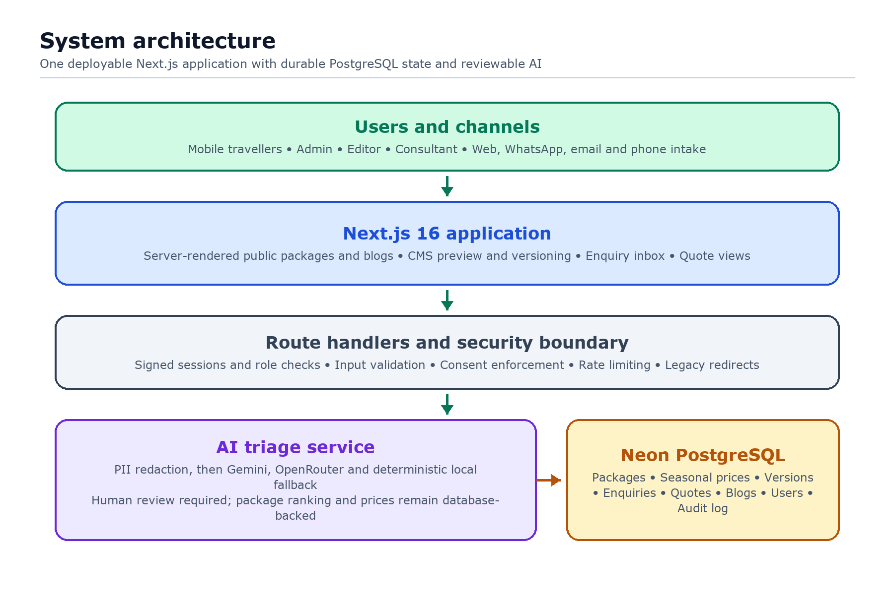
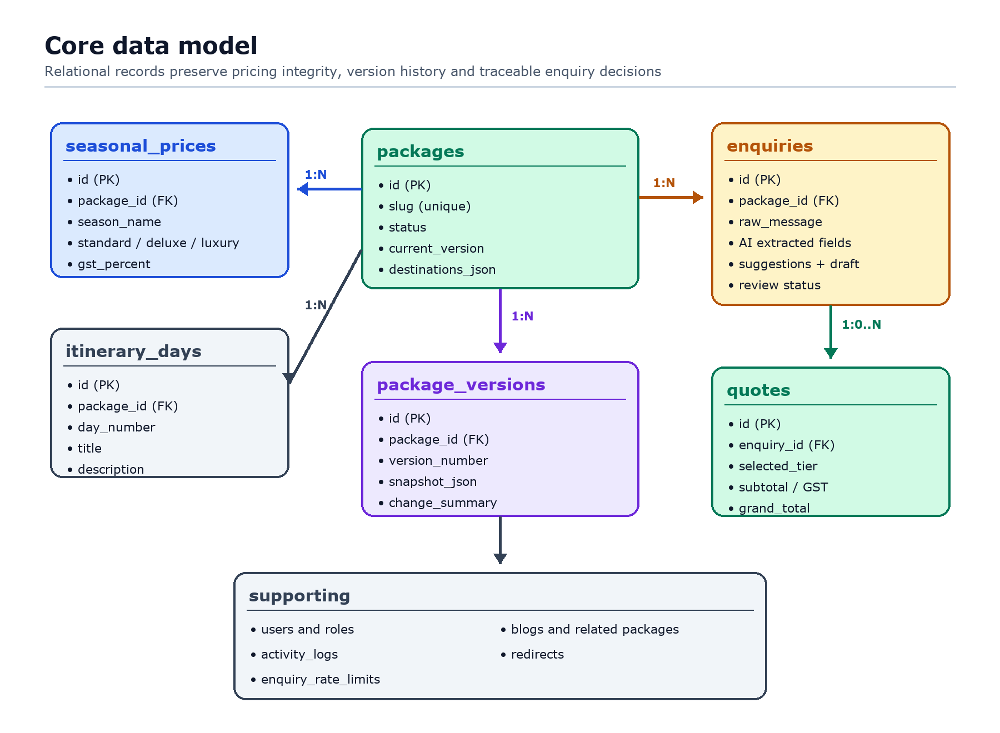
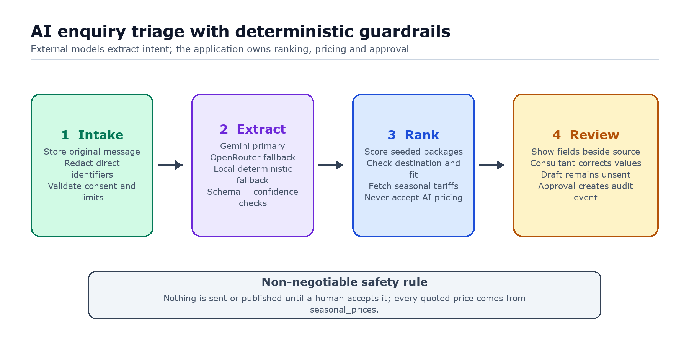
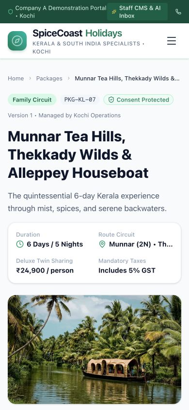
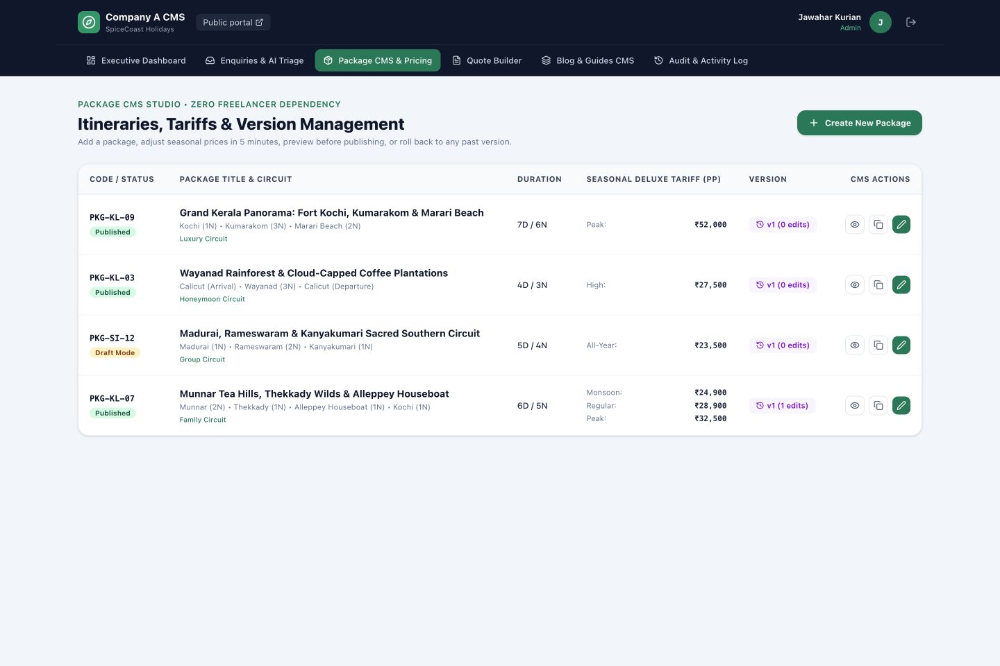
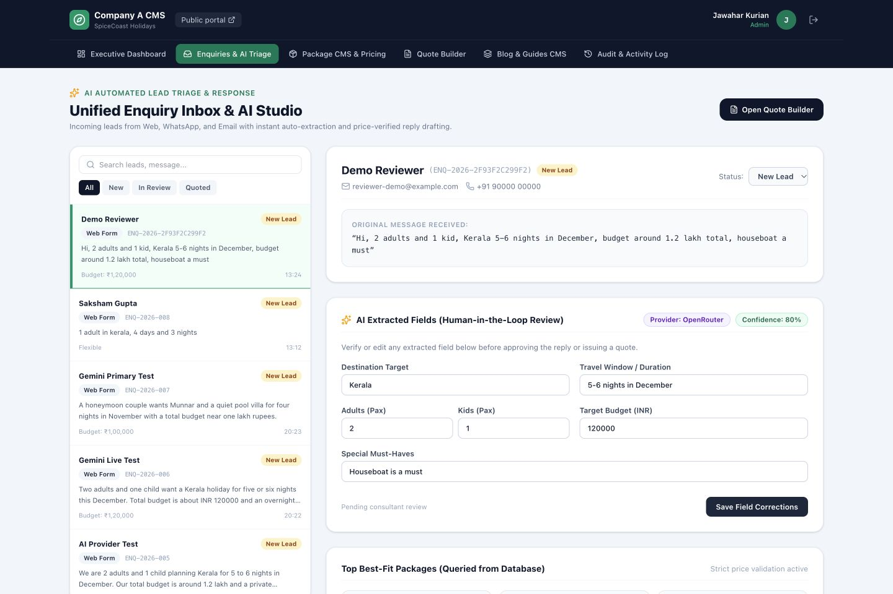

# SpiceCoast Travel CMS Technical Design Document
## Tour Operator Public Portal Package CMS and AI Enquiry Engine
**Candidate:** Saksham Gupta  
**Project GitHub Repository:** [https://github.com/Saksham-Gupta-GH/spicecoast-travel-cms](https://github.com/Saksham-Gupta-GH/spicecoast-travel-cms)
**Live Application:** [https://spicecoast-travel-cms.vercel.app](https://spicecoast-travel-cms.vercel.app)
**Problem Statement:** Brief 1 — Tour operator's website with custom CMS for packages, blogs, enquiries, and AI triage  
**Client Profile:** Company A, Kochi, Kerala (48 staff, ₹28–34 Cr revenue, 4,300 annual bookings across 60 packages)  

---

## 1 Executive Summary and Business Objective

### The Core Problem and Financial Math
Company A sells bespoke Kerala and South India holidays to families, honeymooners, and foreign groups. Their legacy setup caused two severe operational bottlenecks:
1. **Response Time Lag (Loss: ₹52.42 Lakh/yr):** 2,400 monthly enquiries arrive across fragmented channels (web, WhatsApp, email, phone). 25% (600 enquiries) suffer reply delays exceeding 12 hours, crashing conversion from 15% to 7%. This causes **48 lost bookings per month** at an average package value of ₹65,000 and 14% net margin = **₹4.37 Lakh/month = ₹52.42 Lakh/year**.
2. **Content Publishing Bottleneck (Loss: ₹14.4 Lakh/yr):** Every package edit or seasonal price update costs ₹3,000 and 3 days of freelancer delay across 40 monthly changes = **₹14.4 Lakh/year**.
3. **Disconnected Blogs & Excel Sprawl:** Free blogging platforms generated unmonetized traffic with zero package attribution, while quotes were manually assembled in Microsoft Word.

**Total Financial Leakage Addressed:** **₹66.82 Lakh / Year**.

### The Solution Delivered
A unified, server-rendered Next.js 16 application backed by managed PostgreSQL that provides:
* **Public Booking Portal:** High-impact Kerala visual branding, day-wise itineraries, seasonal tariff matrix (twin sharing + assumed 5% GST), and explicit digital follow-up consent.
* **5-Minute Package CMS Studio:** In-place seasonal tariff edits, 1-click package duplication, live preview, and snapshot-based version history with 1-click rollback.
* **Unified Admin Inbox & AI Triage Studio:** Multi-channel aggregation, automatic parameter extraction, top-3 package recommendation, and automated draft replies strictly constrained to database prices (eliminating hallucinations).
* **Optional Depth — Private Traveller Proposal Portal:** Itemized, printable quotes are linked to password-protected traveller accounts. Travellers can approve, decline or request changes; the decision persists for the consultant. The browser print dialog provides Save as PDF; the server does not generate or email a PDF.
* **Optional Depth — Route Maps:** Package and proposal pages render ordered OpenStreetMap circuits without a paid map API.

### Assumptions Used in the Demonstration
Every item below is an implementation assumption rather than a fact supplied by the client:
* **Brand:** “SpiceCoast Holidays,” its logo treatment, address, phone numbers, email addresses, staff names and traveller identities are fictional demonstration data.
* **Catalogue:** Four packages are seeded to demonstrate the 60-package operating model. PKG-KL-07 and PKG-SI-12 preserve the supplied package IDs and prices; other package details, itinerary copy, photos and prices are sample content.
* **Pricing:** The brief requires prices to state per-person basis, twin sharing and GST but does not specify a GST rate. The demo assumes 5% and labels it throughout.
* **Working hours and SLA:** The interface demonstrates a one-hour response target but does not calculate business hours because the brief does not define a calendar or holiday policy.
* **AI:** Enquiry extraction uses Gemini first, OpenRouter second and a deterministic local extractor as the credential-free final fallback. Package ranking and all pricing remain deterministic and database-backed.
* **External channels:** WhatsApp, email, chat and phone ingestion and message delivery are mocked as required by the core-build instructions. Clicking send records an approved reply and timestamp; it does not contact a traveller.
* **Legacy URLs:** Eight representative redirects are implemented from one shared mapping. The actual list of 140 old URLs was not supplied and must be imported during migration.
* **Images:** Remote Unsplash images are used as sample editorial assets and are not client-owned production assets.
* **Maps:** OpenStreetMap tiles and seeded coordinates are demonstration data. Production usage must follow the tile provider policy or use a contracted tile host.

---

<!-- PAGE_BREAK -->

## 2 System Architecture and Technology Choices

*Figure 1. The application uses one deployable Next.js boundary while keeping AI extraction reviewable and all durable content, pricing and versions in PostgreSQL.*

### Why Nextjs 16 App Router
1. **Server-Side Rendering (SSR) for Search & Core Web Vitals:** Tour packages and destination guides require high SEO visibility. Server Components render complete HTML with zero client-side database waterfall; under 2.5 seconds on 4G is the production performance target, not an unverified claim about every free-tier cold start.
2. **Unified Full-Stack Deployment:** Eliminates the operational overhead of running separate frontend and backend microservices. Reviewers need only one command (`npm run dev`) to test the entire system.
3. **Predictable Production Build:** Development uses Next.js defaults, while the production script uses Next.js's supported Webpack path so Tailwind's PostCSS pipeline is compiled deterministically on Vercel.

### Why Managed PostgreSQL on Neon
* **Durable Serverless Writes:** Vercel function filesystems are ephemeral. PostgreSQL keeps package edits, versions and enquiries durable across cold starts and deployments.
* **Free Assessment Deployment:** Neon Free and Vercel Hobby support a public non-commercial evaluation without a paid persistent disk. The client production rollout would use paid capacity, backups and monitoring.
* **Relational Integrity and Scale:** Foreign keys with `ON DELETE CASCADE` keep seasonal prices, itineraries and version snapshots synchronized while allowing multiple stateless application instances.

### Why Vercel for the Assessment Deployment
Vercel is the verified Next.js adapter path and supports the App Router, Server Components, route handlers and proxy used in this build. The application does not rely on Vercel's filesystem for durable state. This is an assessment deployment choice, not an assumption that a free tier is appropriate for Company A's production traffic.

Database connections and schema initialization are lazy: route modules can be compiled without opening a connection, while each database-backed request awaits one shared initialization promise before querying. Public catalogue, package, blog and sitemap routes are explicitly dynamic so they are rendered from current PostgreSQL data rather than captured during deployment. Quote routes are also dynamic but private: signed staff access or matching traveller ownership is required before proposal data is returned.

## 3 Data Model and Entity Relationships

*Figure 2. Package content, tariffs and immutable version snapshots share relational keys; enquiries preserve both the original message and the human-reviewed AI output.*

### Table Specifications
* **`packages`**: Stores package identity, destinations JSON array, category (Family, Honeymoon, Luxury, Group), hotel tier descriptions, and current published version.
* **`seasonal_prices`**: Stores per-person twin-sharing tariffs across Peak, Regular and Monsoon seasons, plus the demo’s assumed 5% GST rate.
* **`package_versions`**: Stores deep JSON snapshots of past revisions, author metadata, and change notes to support 1-click rollbacks.
* **`enquiries`**: Unified lead store supporting Web, WhatsApp, and Email. Houses both raw incoming text and extracted AI attributes.
* **`users`**: Staff identities plus traveller accounts with salted scrypt password hashes for the optional proposal portal.
* **`quotes`**: Itemized proposals with subtotal, 5% GST calculation, validity period, traveller ownership and persisted response state.
* **`activity_logs`**: Append-only application audit trail of package edits, pricing changes, and simulated reply dispatches. Database administrators can still alter PostgreSQL records, so “tamper-proof” is not claimed.
* **`redirects`**: Schema for legacy mappings plus eight representative proxy redirects sourced from one shared mapping. The production migration requires the client’s complete 140-URL export.

---

## 4 AI Triage and Suggestion Engine

### Hybrid, Reviewable Design
The submitted pipeline uses **Gemini structured extraction with OpenRouter and deterministic local fallbacks**. Direct email addresses and phone numbers are redacted before external inference. Every provider response is schema-validated; provider errors, timeouts or invalid JSON fall through safely. Package scoring remains deterministic and prices are always fetched from PostgreSQL, so external model wording cannot create a tariff.

*Figure 3. External AI is limited to structured extraction. Package ranking, price injection and the final approval decision remain inside the application boundary.*

### Safety Constraints Enforced
1. **Prices Come from Database, Never AI:** In accordance with the problem statement (*"prices in drafts come from the package price table, never from the AI"*), pricing numbers in generated draft replies are strictly queried from `seasonal_prices`.
2. **Nothing Sent Without Human Review:** AI drafts remain in `Draft` state inside the admin inbox until Mathew Varghese (Consultant) or Jawahar Kurian (Admin) verifies and clicks **"Approve & Send Tailored Reply"**.
3. **DPDP Consent Safeguard:** Every public enquiry form requires explicit opt-in consent for digital follow-up, logged alongside the lead record. This is one safeguard, not a claim of complete legal compliance.

## 5 Key Interface and Design Decisions

### Visual Identity
A tailored design system inspired by Kerala's natural landscapes:
* **Primary Color:** Emerald Green (`#047857` / `#059669`) reflecting backwaters and Munnar tea hills.
* **Accent Color:** Warm Spice Amber (`#d97706`) for call-to-actions and ratings.
* **Backgrounds:** Slate clean backgrounds (`#f8fafc`) ensuring crisp typography and legibility.

### Screen Breakdown
1. **Public Landing & Search Portal (`/`)**: High-impact Kerala imagery, business credibility strip (48 staff, ₹32 Cr volume, 1-hour reply SLA), featured packages, and interactive enquiry form with brief sample loader.
2. **Holiday Packages Catalog (`/packages`)**: Instant client-side filters for Category (Family, Honeymoon, Luxury, Group) and Destination, showing per-person twin-sharing pricing and 5% GST badges.
3. **Public Package Detail Page (`/packages/[slug]`)**: Server-rendered view with day-wise itinerary accordions, hotel standard comparison, inclusions/exclusions checklist, seasonal tariff matrix and ordered OpenStreetMap circuit.
4. **Package CMS Studio (`/admin/packages`)**: Comprehensive management interface allowing 5-minute price edits, 1-click duplicate package creation, live preview, and version rollback.
5. **Unified Admin Inbox & AI Triage Studio (`/admin/enquiries`)**: Two-pane workspace displaying raw messages side-by-side with editable AI extracted parameters, top 3 suggestions, and editable draft reply.
6. **Executive ROI Dashboard (`/admin`)**: Business metric tracker demonstrating how reducing response lag from 12 hours to under 60 minutes retains ₹66.82 Lakh in annual margin.
7. **Private Traveller Portal and Quote View (`/traveller`, `/quotes/[id]`)**: Linked proposals on Company A letterhead with itemized subtotal, assumed 5% GST, twin-sharing note, route map, browser printing and persisted approval/change/decline controls. Quote data requires a signed staff session or owning traveller account.
8. **In-House Travel Blog & Package Attribution (`/blog` & `/blog/[slug]`)**: Editorial articles hosted directly on-domain that feature direct booking cards for corresponding tour circuits.

<!-- PAGE_BREAK -->

### Key Screens

*Figure 4. The mobile package page leads with the emotional travel image while keeping duration, route, twin-sharing price and GST visible before the enquiry action.*

<!-- PAGE_BREAK -->

*Figure 5. The package studio keeps the four routine editor decisions in one scan: status, route, seasonal tariff and version. Preview, duplicate and edit remain directly accessible without training.*

<!-- PAGE_BREAK -->

*Figure 6. The two-pane inbox preserves the original message beside editable extraction results, provider provenance, confidence and database-ranked packages so a consultant can correct AI output before approval.*

---

<!-- PAGE_BREAK -->

## 6 Testing Quality and Security

### Automated Test Suite
Run via `npm test` using Node's native test runner after configuring `DATABASE_URL`. The suite intentionally exercises the real PostgreSQL adapter and seeded schema:
* **AI Extraction Tests:** Validates extraction of party size (adults/kids), travel window, budget in INR, and must-haves on sample queries from the brief.
* **Package Recommendation Scoring:** Validates that `PKG-KL-07` is selected as the #1 best fit for family + houseboat queries.
* **Price Integrity Verification:** Ensures generated draft replies contain exact numbers from `seasonal_prices` (e.g. ₹32,500 and ₹24,900) and explicitly mention twin sharing and 5% GST.
* **Instant Acknowledgment SLA:** Verifies generation of instant branded acknowledgment templates with reference tracking IDs.
* **Package Versioning & Rollback:** Verifies snapshot generation and historical state restoration.
* **Traveller and Route Unit Tests:** Database-free tests verify salted password hashing, password rejection and route alias normalization.

### Security and Privacy Safeguards
* **No Production Secrets in Repository:** No API keys or production credentials are committed. The documented reviewer accounts and shared demo password are intentionally public test data.
* **DPDP Act 2023 Consent Enforcement:** Explicit opt-in captured before storing lead contact details.
* **Public Enquiry Abuse Controls:** Unauthenticated callers are forced to the consented `web_form` source. A hidden honeypot and a PostgreSQL-backed five-request/ten-minute throttle run before any external AI request; only salted request-identity hashes are stored. On Vercel, the coarse throttle trusts the platform-set `x-forwarded-for` header, combines it with the user agent and never treats that identity as an authentication boundary.
* **Sanitized Inputs:** All PostgreSQL queries use parameter placeholders rather than string interpolation, preventing SQL injection attacks.
* **Authentication and Access Control:** Staff authenticate through a dedicated sign-in page. Travellers claim an unlinked quote by matching its email and quote number, then use a salted scrypt password. The server issues separate signed, HTTP-only, same-site cookies. The proxy's staff cookie-presence check is only an early redirect, not the authorization gate; server layouts, pages and APIs validate the signed session and repeat role or quote-ownership checks. Admins have full access, editors manage packages/blogs, consultants manage enquiries/quotes, and travellers can view only their linked proposals.
* **Server Validation:** Public enquiry payloads enforce name, email, message and length constraints, accepted sources, and explicit consent for digital follow-up. PostgreSQL statements are parameterized.
* **Safe Failure Responses:** Unexpected API details are logged server-side with a request ID; clients receive a generic 500 response instead of database or provider error text.

---

## 7 Tradeoffs Scope and Next Steps

### What Was Cut
1. **Live Flight & Hotel Inventory Sync:** Excluded per the brief (*"Out of scope: Online payment and live hotel or flight inventory"*). Packages feature curated hotel tiers rather than dynamic GDS feeds.
2. **Payment Gateway Integration:** Direct payment checkout was omitted in favor of official quote generation and travel consultant consultation.
3. **Native iOS/Android Applications:** Responsive web layouts were prioritized to deliver an optimal mobile experience for travelers without app store download friction.
4. **Real Message Delivery and Channel Webhooks:** Acknowledgements and consultant sends are recorded in-app only, as instructed by the core build’s mocked outside-systems constraint.
5. **Server-Generated PDF:** Quotes have a print-optimized page and browser Save as PDF flow. Automated file generation, attachment storage and outbound email were not implemented.
6. **Complete 140-URL Migration:** Only representative mappings are included because the legacy URL inventory was not supplied.

### Known Limitations
* The free Vercel and Neon tiers are appropriate for a non-commercial assessment demo, not the stated 2,400-enquiry-per-month production workload. Production needs paid capacity, backups, observability, retention policies and a data-hosting review under the DPDP Act.
* Database schema creation and sample seeding run automatically at application startup for reviewer convenience. Production should replace this with an explicit, versioned migration pipeline.
* The three staff assessment accounts are a hardcoded demo registry with environment-overridable passwords, not a production identity store. Traveller accounts use database-backed salted password hashes, but production should add verified email invitations, password recovery, session revocation and managed identity controls.
* Traveller quote claiming uses the email and quote number as a demonstration invitation. Production should send a short-lived, single-use magic link or OTP rather than treating a quote number as an identity-verification factor.
* External extraction depends on third-party availability and quotas; the local engine preserves the core flow during failures. Direct identifiers are redacted, but a production DPDP review must still assess provider terms, retention, cross-border processing and consent. Low-confidence fields remain editable and nothing is sent without review.
* Scheduled package status is stored, but a background publication scheduler is not implemented in the core slice.
* Remote sample images require network access; production should use an approved media library and image ownership checks.

### Roadmap and Next Steps
1. **WhatsApp Business Cloud API Integration:** Wire the existing AI triage reply generator into official WhatsApp Webhooks with template messaging approval.
2. **Automated PDF Export via Headless Chromium:** Enhance the printable quote view with automated server-side PDF generation attached directly to outbound consultant emails.
3. **Multi-Currency Pricing for Foreign Inbound Groups:** Add automated exchange rate conversion (USD, GBP, EUR) for foreign academic and leisure tours while maintaining statutory INR billing in Kochi.
